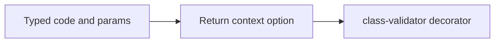
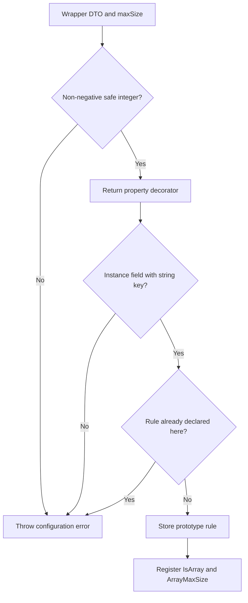
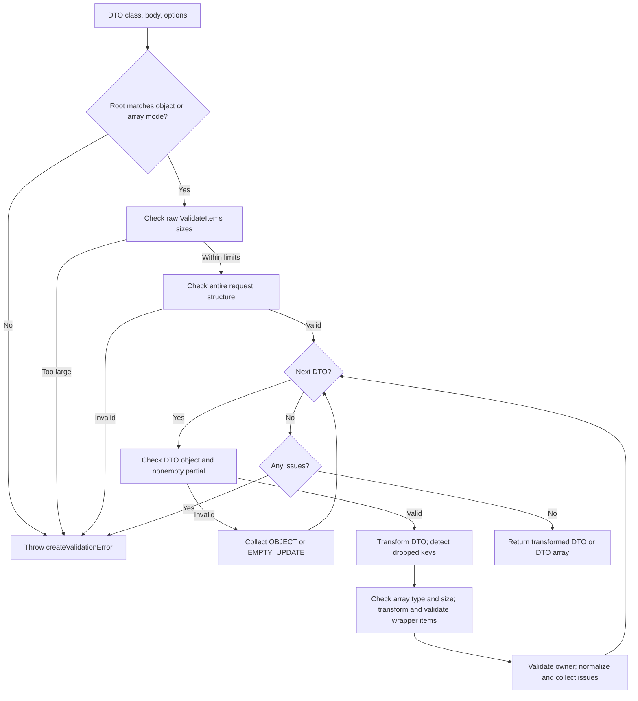
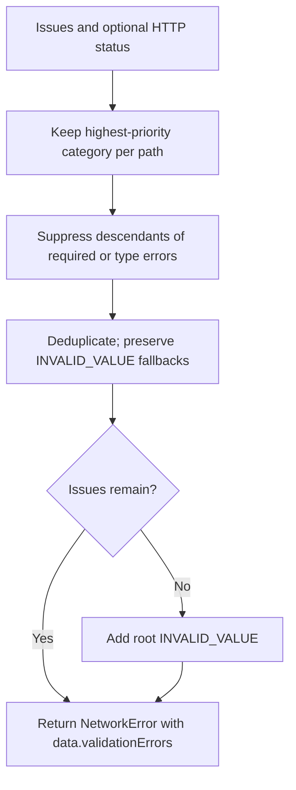

# DTO validation

Import the public API from `src/shared/validation`. The shared package defines error codes and parameter types; the frontend generates user-facing messages.

```ts
import { VALIDATION_CODES as VC } from "@anto-sh/admin-network-shared";
import { IsNotEmpty, IsString } from "class-validator";
import { ValidateItems, validateDto, validationContext } from "./shared/validation";

class LabelDto {
  @IsNotEmpty(validationContext({ code: VC.REQUIRED }))
  @IsString(validationContext({ code: VC.STRING }))
  value!: string;
}

class RequestDto {
  @ValidateItems(LabelDto, { maxSize: 10 })
  labels!: string[];
}

const dto = await validateDto(RequestDto, req.body);
const patch = await validateDto(RequestDto, req.body, { partial: true });
const batch = await validateDto(RequestDto, req.body, { array: true });
```

Persist the returned DTOs: they contain the transformed values that were validated. Batch support is a module capability; existing batch controllers have not been migrated.

## `validationContext`



This helper only wraps metadata. TypeScript checks code/parameter combinations; normalization checks the resulting contexts at runtime. Attach it to each rule; keep `IsNumber` separate from the `IsInt` value constraint.

## `ValidateItems`



The wrapper validates each element through `value`; errors use indexed paths such as `["labels", 2]`, without the technical wrapper segment. The decorator registers the field for the whitelist and shares one size limit between early checks and class-validator. Requiredness and null handling belong to the owning DTO's validators. Rules are inherited, with child rules taking precedence.

## `validateDto`



- `{ partial: true }` sets `skipUndefinedProperties` for owner validation. Ordinary rules skip `undefined`; this option does not skip `IsDefined`. `null` is passed to DTO validation; decorators such as `IsOptional` decide whether it is allowed. Supplied array items are fully validated. Avoid defaults that populate omitted PATCH fields.
- Empty PATCH detection checks the input's own enumerable keys before transformation. `{}` is rejected with `EMPTY_UPDATE`; `{ name: undefined }` is nonempty and can pass if the DTO permits omitting `name` during a partial update.
- Item transformations run before owner checks such as `ArrayUnique`. Array size is checked again after owner transformations; oversized arrays skip item validation. Asynchronous validators are awaited. Batch paths start with a numeric index; an empty root array is accepted.
- Unknown fields are rejected, including keys dropped during transformation. Before transformation, the structural guard rejects `constructor`/`__proto__` (`UNKNOWN_FIELD`), non-JSON object types, depth over 64, and more than 10,000 nodes (`INVALID_REQUEST`). Limits apply to the entire batch. Application transformation exceptions propagate.

## `createValidationError`



Use this function for manual checks as well. It returns an error to throw, defaults to HTTP 422, and uses the common validation message code. Priority is requiredness → base type → value constraints; all issues in the winning category remain. Issues contain `path`, `code`, and optional `params`, without submitted values or class-validator messages. Missing/invalid rule contexts produce `INVALID_VALUE` and a diagnostic; filtering never hides these fallbacks. Validation success is decided before filtering.

## Public types and current limits

| Export | Purpose |
| --- | --- |
| `ValidateDtoOptions` | `partial` and optional `onDiagnostic` callback; overloads additionally select `array: true`. |
| `ValidateItemsOptions` | Required `maxSize` for the owning array. |
| `ValidationDiagnostic` | Only `path` and `constraint`, without submitted values; defaults to `console.warn`. |

- Custom `ValidateItems` discovery covers direct DTO fields and ancestors, not arrays inside nested DTOs. Ordinary `ValidateNested` checks still work.
- Custom item checks run independently of `ValidateIf`; validation groups are not supported by this helper.
- Dropped-key comparison can misclassify `Expose` aliases or transformations that reshape objects.
- class-validator can merge repeated constraints with the same name; use distinct names when failures must remain separate. Business dependencies remain explicit service checks.
- Synchronous custom rules need a nonempty `message` or `defaultMessage` for class-validator to attach their context on failure. An empty message can leave the module without context, producing `INVALID_VALUE` and a diagnostic. The rule message is not included in public validation issues.

## Tests

The public API is covered by Vitest 5.0.5 in the default `node` environment, without a separate Vitest configuration. Tests import [index.ts](./index.ts), declare small local DTOs, and use real class-validator and class-transformer. Express, the application, and the database are not started.

| Test file | Coverage |
| --- | --- |
| [validate-dto.test.ts](../../../tests/validation/validate-dto.test.ts) | Returned DTOs, transformations, input preservation, requiredness, PATCH, root types, and unknown fields. |
| [validate-dto-arrays.test.ts](../../../tests/validation/validate-dto-arrays.test.ts) | Array and batch paths, optional arrays, size checks before and after transformation, and item/owner validation order. |
| [validate-dto-structure.test.ts](../../../tests/validation/validate-dto-structure.test.ts) | Depth and node limits for the whole request, unsafe object types, and forbidden nested keys. |
| [validate-dto-errors.test.ts](../../../tests/validation/validate-dto-errors.test.ts) | Public issue format, priorities, nested paths, context validation, fallback, and diagnostics without submitted values. |
| [create-validation-error.test.ts](../../../tests/validation/create-validation-error.test.ts) | HTTP statuses, manual issues, priorities, descendant suppression, deduplication, and numeric versus string path segments. |
| [validate-dto-async.test.ts](../../../tests/validation/validate-dto-async.test.ts) | Awaiting successful and failed owner, item, and batch validators through controlled Promises. |
| [validate-dto-exceptions.test.ts](../../../tests/validation/validate-dto-exceptions.test.ts) | Preserving the identity of thrown transformation errors and non-Error values, including after earlier validation failures. |
| [validate-items.test.ts](../../../tests/validation/validate-items.test.ts) | Decorator configuration, zero size limit, inheritance, child overrides, and independent array fields. |

`reflect-metadata` is imported first in every test file. [tests/tsconfig.json](../../../tests/tsconfig.json) enables test type-checking and discovery of the legacy decorator settings. Tests are outside `src` and are excluded from the production build.

Run from the backend repository with Node.js 22.16.0 and pnpm 10.11.0. In Windows PowerShell, the installed binaries are:

```powershell
.\node_modules\.bin\vitest.cmd run
.\node_modules\.bin\tsc.cmd --project tests/tsconfig.json
.\node_modules\.bin\tsc.cmd --noEmit
```

The package scripts are `pnpm test` and `pnpm test:type-check`. Pass a test file path to Vitest for a focused run. After changing decorator transformation settings, `.\node_modules\.bin\vitest.cmd --clearCache` can clear stale transformations; cache disabling is not required.

The module and tests require the shared package's validation exports. A local `link:../admin-network-shared` uses that package's built `dist`; rebuild the shared package after changing its sources.
